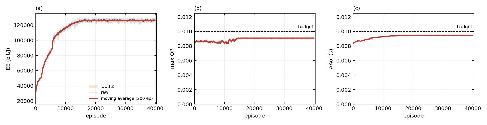

# NSC-PPO: Energy-Efficient Resource Allocation for RSMA-HARQ Satellite–Terrestrial Networks

The satellite acts as the agent and allocates the transmit power and target rate of every HARQ round
of a frame, so as to maximize the long-term average energy efficiency of the cognitive
satellite–terrestrial network under outage and AAoI constraints.

---

## 1. RSMA-HARQ protocol / 协议流程

One frame = $T$ rounds, one round = one slot $T_{\rm slot}$, $K$ users. Per round $t$:

1. **Rate splitting.** Each message is split as $W_k\to\{W_k^{c},W_k^{p}\}$. The $K$ common parts are
   jointly encoded into the common stream $s_{c,t}$, each private part into its own stream $s_{k,t}$.
2. **Superposition.** $\mathbf s_t=[s_{c,t},s_{1,t},\dots,s_{K,t}]^{T}$ with
   $P_{c,t}+\sum_k P_{k,t}=P_{s,t}$, where $P_{s,t}$ is capped by the cognitive (underlay)
   interference constraint of the primary network and by $P_{\max}$.
3. **Type-I HARQ.** Every round is encoded with an independent randomized codebook, so a repeated
   copy leaks no extra information; the receiver keeps the round with the highest SINR among the $T$
   copies. Retransmission is **per stream**, not per message.
4. **SIC.** SU$_k$ decodes $s_{c,t}$ first, with the private streams and the terrestrial BS signal as
   interference, then removes the common stream and decodes $s_{k,t}$, leaving the residual SIC
   factor $\Xi_k$ ($\Xi_k=0$ is perfect SIC).
5. **ACK / NACK.** ACK only if both streams are decoded; otherwise NACK and that stream is
   retransmitted. The frame stops when all users have succeeded or $T$ rounds are used up.
6. **wait-for-all.** The next frame starts only after every user has decoded the current one, so the
   rounds of a frame are coupled through the AAoI. A frame is therefore the decision unit: the $T$
   rounds are pre-allocated as one template, and the entries of a user that has already decoded are
   zeroed in the following rounds.

The two SINRs of step 4 are

$$\gamma_{k,c,t}=\frac{P_{c,t}\mathcal A}{(\sum_i P_{i,t})\mathcal A+P_{B,t}\mathcal B+\mathcal C},
\qquad
\gamma_{k,p,t}=\frac{P_{k,t}\mathcal A}{(\sum_{i\ne k}P_{i,t})\mathcal A+P_{B,t}\mathcal B+\Xi_kP_{c,t}\mathcal A+\mathcal C}$$

with $P_{c,t}=P_{s,t}\alpha_{c,t}$, $P_{k,t}=P_{s,t}\alpha_{k,t}$. The allocation controls three
metrics: the cumulative outage $P_{{\rm out},k,T}=\prod_tP_{s,k,t}$, the AAoI
$\overline\Delta_{(K,T)}$ (multi-user waiting penalty plus average transmission time), and
$\eta_{\rm EE}=B\overline R_T/\overline P_T$, where $\overline R_T$ and $\overline P_T$ are weighted
by the probability that each round is actually reached.

## 2. NSC-PPO / 算法

The actor output is not executed directly: it passes through a **soft validity mask** (a
differentiable violation degree) and a **differentiable projection layer** (closed-form outage and
AAoI expressions inside the actor), and only then reaches the environment. The mask guides learning
away from infeasible actions; the projection makes the linear power and SINR constraints hold exactly
and reduces the OP/AAoI violation.

| Element | Definition | Dim ($K=4$, $T=3$) |
| :--- | :--- | ---: |
| State | previous $[\mathbf R_{\rm c,th},\mathbf R_{\rm p,th},\mathbf P_c,\mathbf P_k]$, $\{P_{{\rm out},k,T}\}$, AAoI | **26** |
| Action | frame-level rate / power template | **21** |
| Reward | $\eta_{\rm EE}(a^{*})$ scaled by $10^{-4}$ | scalar |

```text
Algorithm 1  NSC-PPO training
input : env, episodes J, gamma, lambda, xi, alpha, I, eta, rho
output: policy pi_theta

1  init pi_theta, pi_theta_old <- pi_theta, V_phi, buffer D <- empty
2  for j = 1 ... J do
3      s_1 <- env.reset()
4      for n = 1 ... N_T do
5          a_n ~ pi_theta(.|s_n)                  # 24-dim latent -> 21-dim action
6          a*_n <- Proj(a_n)                      # see Proj below
7          r_n, s_{n+1} <- env.step(a*_n)         # r_n = eta_EE(a*_n) / 1e4
8          D <- D + {(s_n, a_n, a*_n, r_n, s_{n+1})}
9      end
10     A_hat <- GAE(gamma, lambda) over D
11     phi <- phi - alpha_c * grad (V_phi - R_hat)^2
12     theta <- theta - alpha * grad [ -L_PPO + lam_valid*v_valid + lam_align*||a - a*||^2 - xi*H ]
13     pi_theta_old <- pi_theta ;  D <- empty
14 end

Proj(a):
15     v_valid(a) <- soft mask                        # SINR / OP / AAoI / power violation
16     repeat I times:
17         a <- a - eta * grad_a L_pen(a)             # L_pen = ||a - a_n||^2 + rho*(OP + AAoI excess)
18         a <- repair(a)                             # box -> power budget -> SINR (5% margin)
19         keep the step only if L_pen decreases
20     return restore(repair(a))                      # Newton power step + rate bisection
```

Step 20 is what certifies $\max_kP_{{\rm out},k,T}\le\delta_s$; `--no-restore` drops it and follows
the paper's Algorithm 1 literally. `repair` is the closed-form map onto {box, power budget, SINR
feasibility} used by both the projection and the environment.

## 3. Quick start / 运行步骤

```bash
pip install -r requirements.txt

python nsc_ppo.py                                 # full run, 4e4 episodes
python nsc_ppo.py --episodes 200                  # smoke test
python nsc_ppo.py --eval runs/final/checkpoints/nsc_ppo.pt
python nsc_ppo.py --plot-only                     # redraw from an existing log
python nsc_ppo.py --no-restore                    # ablation: repair + PGD only
```

Training writes `runs/final/{train_log.csv, metrics.json, curve.png}`,
`runs/final/checkpoints/{actor.pt, critic.pt, nsc_ppo.pt, best.pt, final.pt}`, and copies the figure
to `results/curve.png`. Options: `--episodes --rollout --epochs --lr-actor --lr-final --decay-frac
--seed --threads --op-budget --aaoi-budget --out --results --smooth --eval-episodes`.

## 4. Results / 结果



| | episode 1 | episode 4 × 10⁴ |
| :--- | ---: | ---: |
| Energy efficiency (bit/J) | 2.12 × 10⁴ | **1.30 × 10⁵** |
| max OP | 8.72 × 10⁻³ | 9.12 × 10⁻³ |
| AAoI (s) | 8.1 × 10⁻³ | 9.5 × 10⁻³ |
| average power | 2.72 × 10³ | 3.99 × 10² |

90 % of the final value is reached at episode 8.7 × 10³, and after episode 1.6 × 10⁴ — where the
schedules freeze — the curve is flat: mean 1.26 × 10⁵, s.d. 1.3 %, first-to-last change −0.1 % over
the remaining 2.4 × 10⁴ episodes. max OP and AAoI stay below $10^{-2}$ in all 4001 logged rows. The
gain comes from cutting the average power rather than from raising the rates.

## 5. Hyper-parameters / 超参

| Symbol | Value |
| :--- | ---: |
| $\gamma$ / GAE $\lambda$ / clip $\varepsilon$ | 0.45 / 0.95 / 0.2 |
| Actor / critic learning rate | $3\times10^{-4}$ / $8\times10^{-4}$ |
| Entropy bonus $\xi$ | $10^{-2}\to10^{-3}$ |
| Soft-mask weight $\lambda_{\rm valid}$ / alignment $\lambda_{\rm align}$ | 1.5 / 1.8 |
| Projection steps $I$ / step size $\eta$ / penalty $\rho$ | 3 / 1.0 / 1.0 |
| Hidden units / minibatch / epochs | 2 × 128 / 64 / 4 |
| Rollout / frames per episode / episodes | 32 / 16 / $4\times10^{4}$ |
| $K$ / $T$ / $W$ / $T_{\rm slot}$ | 4 / 3 / 50 MHz / 5 ms |
| $P_{\max}$ / $R\in[R_{\min},R_{\max}]$ | 3500 / [0.1, 3] |
| $\delta_s$ / $\widetilde\Delta$ | $10^{-2}$ / $10^{-2}$ s |

Learning rate, entropy coefficient and exploration noise are annealed by the same cosine schedule and
**all freeze at 40 % of the budget** (episode $1.6\times10^{4}$), so the remaining 60 % of the
run sits on a fixed point.


MIT licence, see `LICENSE`.
